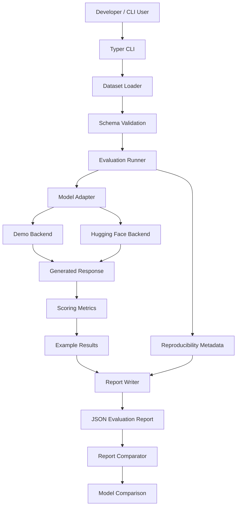
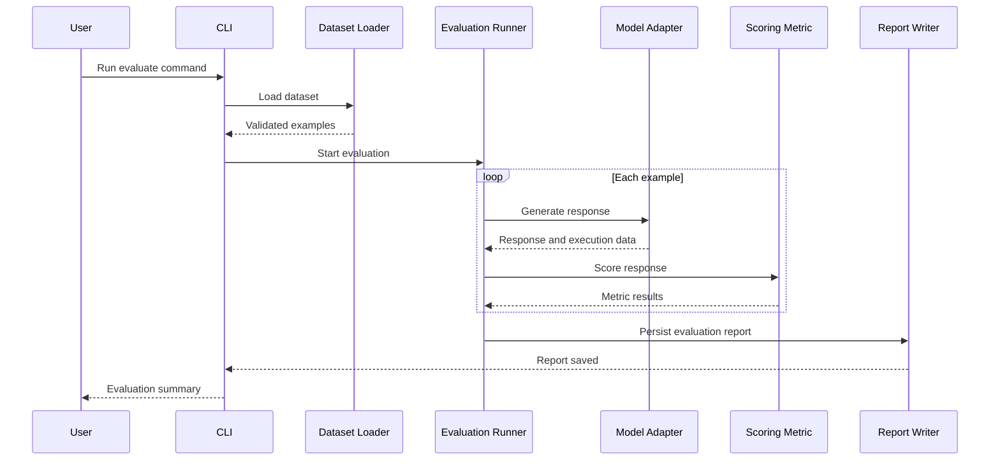

# Architecture

## Overview

`llm-eval-benchmark` evaluates language models against a versioned JSONL dataset. It separates dataset validation, model execution, scoring, and reporting so that evaluation components can be tested and extended independently.

## System architecture

## Component responsibilities

### 1. CLI

The Typer-based CLI exposes evaluation and report comparison commands. It accepts dataset paths, backend selection, model configuration, and generation settings.

### 2. Dataset loader and schema validation

The loader reads JSONL examples and validates their structure before evaluation. It also checks dataset-level requirements, such as duplicate IDs.

### 3. Evaluation runner

The runner coordinates the evaluation lifecycle:

1. Loads validated examples.
2. Invokes the selected model adapter.
3. Captures the generated response and execution metadata.
4. Applies the appropriate scoring metric.
5. Records results, latency, throughput, and errors where available.
6. Produces an evaluation report.

### 4. Model adapters

The adapter layer separates model execution from the evaluation pipeline.

- **Demo backend:** Supports development and pipeline testing without relying on a real model's quality.
- **Hugging Face backend:** Runs supported Hugging Face models and returns generated responses for evaluation.

The adapter boundary makes it easier to add another inference backend without rewriting the scoring pipeline.

### 5. Scoring metrics

The metrics layer maps each example's `scoring_method` to the corresponding evaluator. Supported methods include JSON schema validation, keyword matching, phrase matching, normalized exact match, output constraints, reference-based text metrics, semantic similarity, and LLM-as-judge evaluation.

Optional metrics may require additional dependencies or configuration.

### 6. Report writer

The report writer persists structured JSON containing evaluation results and available execution metadata. Reports provide a record of what the benchmark measured and can be used for later comparisons.

### 7. Report comparator

The comparator reads two existing reports and compares their aggregate scores and per-metric results. Comparisons are most meaningful when the reports use compatible datasets, settings, and scoring definitions.

## Typical evaluation sequence

## Design principles

- **Separation of concerns:** Dataset loading, inference, scoring, and reporting have distinct responsibilities.
- **Extensibility:** New adapters and scoring methods can be introduced independently.
- **Testability:** Components can be tested using deterministic examples and fake adapters.
- **Reproducibility:** Dataset identity and available environment and configuration metadata help explain differences between runs.
- **Optional dependencies:** More specialized metrics can be installed when needed.

## Limitations

- Model outputs may be nondeterministic, even with identical prompts and settings.
- Reproducibility metadata does not guarantee bit-for-bit identical results across hardware and library versions.
- Benchmark scores depend on dataset quality and the selected scoring methods.
- The demo backend validates the benchmark workflow, not real-world model capability.
